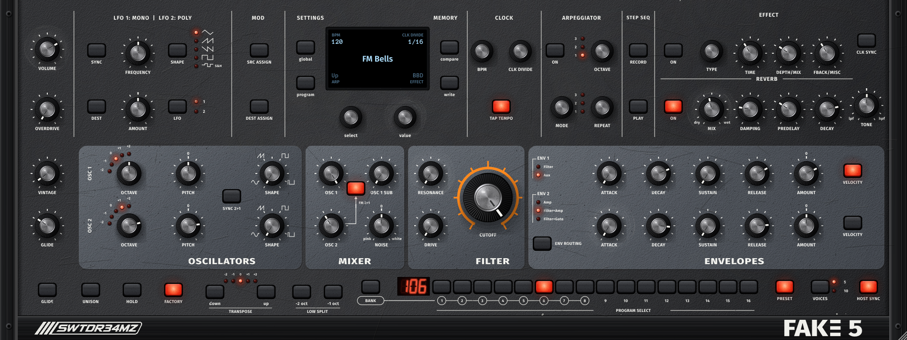

# FAKE5

A 5-voice (or 10-voice) polysynth in the manner of the Sequential **Take 5**, as a **VST3** for Windows and the Mac,
an **AU** for the Mac, a **standalone app** and a plugin for **Akai MPC** hardware. By **swtdr34mz**. Its sound is its
own: two oscillators with the Take 5's continuous SHAPE (sine → saw → square → narrow pulse), **linear FM 2>1**, a
4-pole ladder low-pass with DRIVE, OVERDRIVE, VINTAGE, an effect and a **plate reverb**, built on the band-limited
oscillators of [PROPHET 67](https://github.com/swtdr34mz-afk/PROPHET-67-VST) and [REEVES](https://github.com/swtdr34mz-afk/REEVES).

Unofficial: not made, endorsed or supported by Sequential.



## Download

[Actions](https://github.com/swtdr34mz-afk/FAKE5/actions) → the newest green run → **Artifacts** at the bottom:
`FAKE5-Windows`, `FAKE5-macOS` or `FAKE5-MPC` (a GitHub sign-in is needed for artifacts).

## Installieren (kurz auf Deutsch)

**Windows (Cubase):**
1. Zip entpacken.
2. Den Ordner `FAKE5.vst3` nach `C:\Program Files\Common Files\VST3\` kopieren.
3. Cubase starten (oder *Studio → VST-PlugIn-Manager → Aktualisieren*). FAKE5 steht unter den Instrumenten,
   Hersteller swtdr34mz.
4. `FAKE5.exe` ist die Standalone-App. Audio- und MIDI-Gerät stellt man unter *Options* ein.

Windows SmartScreen kann beim ersten Start der App warnen (sie ist nicht signiert): *Weitere Informationen →
Trotzdem ausführen*.

**Mac (Ableton, Logic, ...):** Am besten die `.tar.gz` nehmen (Doppelklick entpackt sie). `FAKE5.vst3` nach
`~/Library/Audio/Plug-Ins/VST3/`, `FAKE5.component` nach `~/Library/Audio/Plug-Ins/Components/`. Dann einmal im Terminal:
```
xattr -cr ~/Library/Audio/Plug-Ins/VST3/FAKE5.vst3 ~/Library/Audio/Plug-Ins/Components/FAKE5.component
```
Die Plugins laufen auf Apple Silicon und Intel-Macs (eine Datei für beide).

**MPC:** siehe [mpc/plugin/README.md](mpc/plugin/README.md).

## What it has

- **5 or 10 voices** (VOICES on the panel).
- Per voice: **two oscillators** with continuous SHAPE, hard **SYNC 2>1**, per-oscillator key tracking, osc 1
  **sub octave**, pink/white **noise**, **FM 2>1** (linear, through-zero-free, osc 2's level sets the depth),
  a **4-pole ladder low-pass** with RESONANCE, DRIVE (a stage of its own before the filter: driven, the resonance
  keeps its bite and growls) and key tracking, two **DADSR** envelopes with the Take 5's
  **ENV ROUTING** (Filter/Amp, Aux/Filter+Amp, Aux/Filter+Gate) and envelope **repeat**.
- **LFO 1 (mono)** and **LFO 2 (poly)**: five shapes, clock sync, slew, key reset.
- **Modulation**: 16 slots of 19 sources and 57 destinations (the Take 5's lists), including audio-rate
  modulation from osc 2, noise and the filter output.
- **VOICE SPREAD**: its own knob (the Take 5 patches Voice Spread to Panning in the matrix): each voice its place in
  the stereo field, a hair of detune and colour of its own, the far side a fraction of a millisecond late.
- **VINTAGE** (per-voice tuning and envelope spread, drift), **GLIDE** (polyphonic, per-oscillator), **UNISON** with
  CHORD memory, **LOW SPLIT**, **TRANSPOSE**.
- **EFFECT** with 12 types (Delay Stereo, BBD, Tape 1 / 2, Chorus, Flanger, Phaser, HP Filter, Distortion, Ring Mod,
  Rotating Speaker, Lo-Fi) and a **plate REVERB** (MIX, DAMPING, PREDELAY, DECAY up to 12 s, TONE).
- **Arpeggiator** (modes, octaves, repeats, relatch) and a **64-step sequencer** (up to 10 notes a step, rests, ties,
  transpose while playing).
- **HOST SYNC**: clock, synced LFOs and delays follow the DAW.
- 64 factory programs of its own plus the Basic Program; WRITE keeps your own (Documents/FAKE5/Programs).
- **LOAD SYX**: a Take 5's own sounds from a .syx file (its factory sets, your programs) become your programs. FAKE5
  ships none of Sequential's sounds; it reads the files you have.
- **QUALITY** (GLOBAL page): HIGH runs the oscillators and filter at 4x the sample rate, ECO at 2x (less CPU).

## The panel

The panel is the Take 5 desktop module's (no keys: play it from a MIDI keyboard or the DAW). **program** and
**global** open the menus on the display, **select** picks a line, **value** sets it. **load syx** (under write)
reads a Take 5 SysEx file. In MOD: press **SRC ASSIGN**
and turn **select** for the source, then **DEST ASSIGN** and touch the knob you want to modulate.

## Building

```
cmake -B build -DCMAKE_BUILD_TYPE=Release
cmake --build build --config Release
```
JUCE 8 comes from GitHub. The engine's tests: `cmake -S tests -B build-tests && cmake --build build-tests && build-tests/engine_tests`.

## Licence

MPL-2.0 (LICENSE). Fonts: Fira Sans and Anonymous Pro, SIL Open Font License (fonts/).
